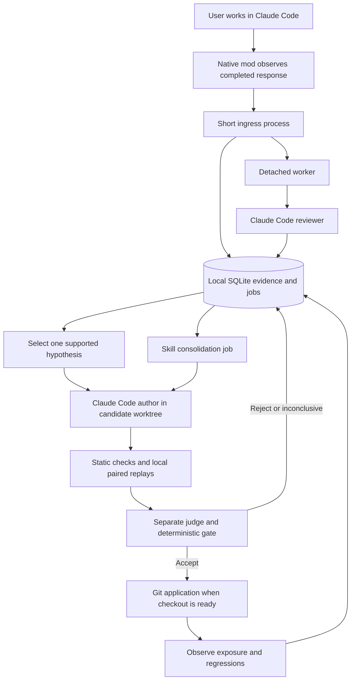
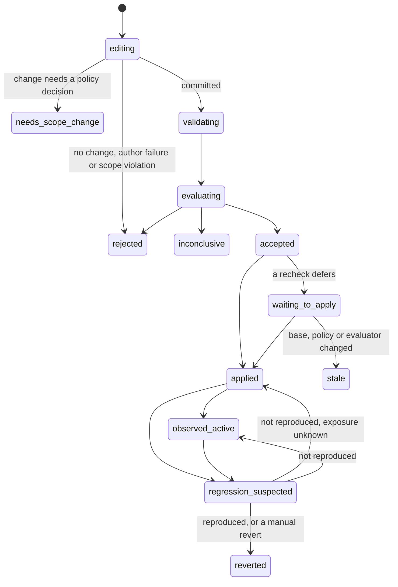

# Architecture

This describes the implemented system (milestones M0 to M7), tested against Claude Code CLI 2.1.306 on macOS with
a scripted fake CLI. Each section says where the code differs from the original design. Native mod APIs are early
access and may change between Claude Code releases.

## 1. System boundary

A small TypeScript mod observes the session lifecycle and a Python 3.11+ worker does the durable work. The worker
uses only the Python standard library: SQLite, subprocess management, hashing and file handling. Git is the only
harness history mechanism. There is no service to install, no server, no vector database and no Docker
dependency.



The mod observes. The worker coordinates. Claude reviews, authors and judges. A deterministic gate decides
whether all required conditions hold. The authoring model never applies its own work to the user's checkout.

## 2. Native mod integration

Package layout:

```text
.claude-plugin/plugin.json
hooks/hooks.json                 # modules: ["./register.ts"]
hooks/register.ts                # literal event registrations and the /autotune command
hooks/register.test.ts           # run by `claude plugin test .`
autotune/                        # Python worker package (python3 -m autotune)
prompts/                         # reviewer, author, judge, curator
schemas/                         # envelope, review, author, judge, curator, case
tests/                           # Python tests, the fake Claude CLI and fixtures
evals/                           # native plugin eval cases (not run yet)
benchmarks/                      # fixture harness, gate mutation set, latency results
calibration/                     # calibration example format and synthetic seed set
```

The mod registers literal events and uses documented mod APIs only. The
[native mod reference](https://code.claude.com/docs/en/plugins/mods/reference) supplies event contracts, and the
[mods API](https://code.claude.com/docs/en/plugins/mods/api) supplies session and subprocess access.

| Event | Autotune action |
|---|---|
| `classic.SessionStart` | Start or continue a lifecycle record (source, transcript path, cwd); a clear or resume starts a new lifecycle |
| `classic.InstructionsLoaded` | Record main-loop instruction files as loaded (not fired under `claude -p`; see section 9) |
| `skill.prompt` | Record skills the main loop's own Skill calls supplied, plus a typed `/skill` just before a turn |
| `turn.start` | Record the request and turn identity; send a `turn_start` envelope (foreground activity); resend up to two kept envelopes |
| `tool.call` | After `next(e)` returns, record bounded metadata of the main loop's own tool calls |
| `turn.complete` | Build and send the `turn_complete` envelope once; show a one-line status |
| `session.end` | Best-effort `session_end` envelope (foreground activity ends) |
| `session.start` | Register the `/autotune` command; resend kept envelopes |
| `command.run` (`autotune`) | Run `python3 -m autotune <args> --project-dir <cwd>` and return its output |

Subagent turns and subagent tool calls are ignored. Sessions whose environment marks them as Autotune review,
author, judge or replay work (`AUTOTUNE_ORIGIN`) capture nothing and start no worker. Every handler calls
`next(e)` and returns its value unchanged; a capture failure never turns a successful response into an error.

An ingress call that fails after one in-hook resend is kept in `$.store` (at most 20 envelopes and 600 KiB) and
resent at the next turn start or session start. Deduplication by `(session_id, turn_id)` makes resends safe.

## 3. Capture and durable ingress

Each episode uses the native `(session_id, turn_id)` pair as its deduplication identity. A `lifecycle_id` records
the initial load, clear or resume segment as metadata; it does not change the identity of a redelivered
completion.

The mod captures a bounded record at the completion boundary:

- the request text, the assistant answer, the end reason and timing;
- bounded tool call and result metadata, skills used and instruction files loaded;
- repository identity, branch, observed HEAD and dirty-state flags (added by ingress, which runs Git);
- coverage metadata: truncated fields, dropped tool calls, a missing turn start, capture errors and unsupported
  media.

Ingress assigns episode-local evidence IDs (`e0001`, ...) with kind, role, content, capture position and
provenance. Evidence kinds are `user_request`, `assistant_answer`, `end_reason`, `tool_call`, `tool_result`,
`skill_load` and `instruction_load`. Content is redacted before storage. The transcript path is recorded but the
transcript is not read.

The envelope is capped at 512 KiB before ingress. Ingress runs through `$.process.run` with an argument vector and
stdin, never a shell string. It validates the envelope, writes the episode, evidence and review job in one SQLite
transaction (Git calls happen before the transaction), writes one JSON acknowledgement line, and starts or wakes
the detached worker. The mod waits at most one second for ingress. Exit codes: 0 ok, 2 invalid envelope (never
resent), 3 persistence failure (kept and resent). When the data directory is over its cap, ingress refuses the
turn and writes a line to `capture-errors.jsonl`, which needs no database space.

Measured latency is in [RELEASE_EVIDENCE.md](RELEASE_EVIDENCE.md). The 150 ms p95 target applies to each blocking
hook call; both calls meet it, and the per-turn sum of about 196 ms p95 is reported and accepted for the
experimental release.

## 4. Worker and queue

The worker is a detached, on-demand process, one per project, guarded by `worker.lock` in the data directory. It
exits after `worker_idle_seconds` (30 by default) with no eligible work. New ingress, `/autotune resume` and
`/autotune retry` start it. It finishes queued work after the Claude session closes; there is no OS daemon.
Machine sleep or shutdown pauses progress until the next start.

SQLite runs in WAL mode on a local filesystem with short write transactions and a busy timeout. A job lease has an
expiry and a heartbeat on its own thread and connection. No transaction is held across a model call, Git operation
or test run. A handler's database writes run in the same transaction that completes its job, and only while the
worker still holds the lease.

Job types and priorities (lower runs first): `review` 10, `apply` 20, `verify_active` 25, `reproduce_regression` 30,
`propose` 40, `evaluate` 50, `consolidate` 60. Expired leases are reclaimed. Only one candidate per project can be
in an active state (proposed to waiting_to_apply) at a time. A machine-wide `experiment.lock` in
`~/.claude/autotune/` lets one evaluation run at a time across all projects. A running job is not preempted; the
worker picks the highest-priority job when the current one ends.

Transient failures retry with bounded exponential backoff and jitter, up to `max_attempts`. Authentication
failures, budget exhaustion and environment problems (a missing CLI, disk cap, unavailable handler) block the job
in `blocked_auth`, `blocked_budget` or `blocked_environment` until `autotune retry`, or, for budget, until the next
UTC day. Infrastructure failure is never turned into a poor rating.

Foreground activity is recorded separately from job leases, from `turn_start`, `turn_complete` and `session_end`
envelopes ordered by their send time. Application defers while a session has been active in the last six hours
with no end recorded.

Exactly-once model execution is not promised. An interrupted request may have consumed tokens. Each attempt has a
`model_calls` row reserved before the call and settled after it; Git application is idempotent through commit
trailers.

## 5. Local storage

Data directory: `~/.claude/autotune/<project-id>/` (mode 0700; `AUTOTUNE_HOME` replaces the base). The project id
is the first 16 hex characters of the SHA-256 of the repository's real Git common directory. Worktrees of the same
repository share evidence; branch and base commit scope each experiment. Moving the repository gives it a new id
and a new, empty store.

| Table | Main purpose and fields |
|---|---|
| `meta` | Schema version, pause flags (`paused`, `apply_paused_reason`, `git_reconciliation_required`), last sweep time, consolidation attempts |
| `episodes` | Session/turn identity, lifecycle, completion time, end reason, coverage, repository state, loaded harness, review status |
| `evidence` | Episode-local IDs, redacted content, kind, role, provenance, retention deadline |
| `foreground_activity` | Per-session state (active, idle, ended) and when it was last updated |
| `capture_errors` | Capture failures reported by the mod or ingress |
| `jobs` | Type, deduplication key, state, lease, attempts, next eligible time, error code, cancel request |
| `model_calls` | Job and attempt, role, requested and resolved model, usage, cost, outcome, accounting uncertainty |
| `reviews` | Episode, dimensions, findings, evidence IDs sent and omitted, adjustments, failure signature, reviewer model, rubric identity |
| `candidates` | Hypothesis, source reviews, scope, change kind, base/candidate/applied/reverted SHAs, required cases, gate result, status, reason, exposure |
| `evaluation_runs` | Candidate, case, arm, trial, attempt, outcome, checks, environment, model, CLI build, fixture digest, harness commit, usage, duration |
| `skill_events` | Skill path, event (`load`, `invocation`, `edit`, `merge`, `outcome`), episode or candidate link |

The schema is version 3 with migrations from versions 1 and 2. Foreign keys are enforced. The store holds
observations, decisions and referenced SHAs only. It holds no harness versions, snapshot trees or patch archives;
`git show`, `git diff` and `git log` give file history. Besides the database, the data directory holds the
rotated log (`logs/autotune.log`), lock files, the empty `neutral/` working directory for tool-free calls,
candidate and revert worktrees, and `capture-errors.jsonl`. The only evidence kept outside the database is the
capped diff of a candidate rejected by scope validation (`<data dir>/candidates/<id>.diff`), kept for inspection
because its branch is deleted.

Retention: evidence content expires after `raw_retention_days` (30); the row stays, marked expired, so a review
that cites it shows the citation as unverifiable. Ordinary review and run detail expires after
`result_retention_days` (180). Branches of rejected and inconclusive candidates older than that are deleted and
the candidate records `branch_deleted_at`. Applied and reverted decision records, regression signatures and
protected case links are kept. The data directory has a size cap (`max_data_mb`, 1024): over it, the oldest
evidence expires first and the log rotates at `log_max_bytes`.

Failure signatures, affected paths and task families are matched exactly. There is no semantic retrieval.
Recurrence counts use distinct sessions, not repeated turns in one conversation.

## 6. Claude Code adapter

`autotune/claude_cli.py` runs every model call as a `claude -p` subprocess with an argument vector and the prompt
on stdin. It never uses `--bare` (which drops subscription OAuth) or `--dangerously-skip-permissions`. Each call
reserves a `model_calls` row against the daily budget for its group before it starts: reviews against
`review_calls_per_day`, author, judge, curator and replay calls against `experiment_calls_per_day`.

| Profile | Roles | Flags |
|---|---|---|
| reviewer | review, judge, curator | `--safe-mode --tools "" --strict-mcp-config`, `--json-schema`, neutral empty working directory |
| author | author | `--safe-mode --restricted --tools Read,Edit,Write,Glob,Grep --permission-mode acceptEdits --strict-mcp-config`, in the candidate worktree; Bash, web and agent tools are always removed |
| replay | replay | `--setting-sources project --strict-mcp-config --permission-mode dontAsk --output-format stream-json --verbose`, the case's tools and `--allowedTools Bash(...)` rules, `--settings {"autoMemoryEnabled": false}` |

All calls add `--no-session-persistence`. Safe mode is right for independent review and authoring. It is wrong for
replay, which must load the harness being evaluated.

Authentication uses the user's normal Claude Code sign-in and config directory. A fresh `CLAUDE_CONFIG_DIR` loses
the subscription login, so neutrality comes from flags, not from a separate configuration. Before the first call
(and every ten minutes) the adapter runs `claude auth status --json` and requires a claude.ai login with the
first-party provider. The child environment drops `ANTHROPIC_API_KEY`, `ANTHROPIC_AUTH_TOKEN`, `ANTHROPIC_BASE_URL`
and the Bedrock, Vertex and Foundry switches unless `allow_api_key` is true, so an inherited key cannot silently
change billing. It also drops variables inherited from the parent session and sets `AUTOTUNE_ORIGIN` and
`AUTOTUNE_NO_WORKER`, so a model process cannot capture its own turns. Autotune never reads keychain material.

A zero exit code is not a valid result. The adapter requires the structured output when a schema was given, and
classifies failures (`auth_required`, `rate_limited`, `usage_limit`, `overloaded`, `server_error`, `timeout`,
`invalid_output`, `cli_missing` and others). It records the actual model from `modelUsage`. A timeout or
cancellation kills the whole process group. Output over 8 MiB is truncated and the call is `invalid_output`.

## 7. Candidate lifecycle and Git application



`proposed` exists in the schema but the propose job inserts candidates directly as `editing`. `stale`, `rejected`,
`inconclusive` and `needs_scope_change` are terminal for that candidate; a later review with new evidence creates a
new candidate. A candidate in `needs_scope_change`, `rejected` or `inconclusive` counts as a prior attempt at its
failure signature, so the same failure is not re-authored without new evidence.

1. Select the current HEAD on the current branch as the base. If the checkout has uncommitted changes at the
   editable paths, defer with `checkout_dirty`; never commit or stash the user's work.
2. Create branch `autotune/<candidate-id>` and a worktree under `<data dir>/worktrees/` with hooks disabled.
3. Give the author one hypothesis and the allowed paths. Validate the resulting diff: paths, protected files,
   symlinks, path escapes, executable bits, binary and oversized files, submodules, and JSON field rules for
   `.claude/settings.json`, `.claude/settings.local.json` and `.mcp.json`.
4. Commit the candidate with a unique `Autotune-Candidate: <id>` trailer.
5. Evaluate it (section 8) and store the gate result.
6. Apply when accepted: automatically when `automatic_apply` is true, otherwise on `autotune apply <id>`. Under
   `apply.lock`, recheck in order: the branch, HEAD equal to the base, policy digest and evaluator identity, no
   tracked, staged or untracked change at the candidate's paths, no active foreground session, no pause flag.
   A failed recheck leaves the candidate waiting with the exact reason, or makes it stale.
7. Apply with `git merge --ff-only` (hooks disabled). Never rebase an evaluated candidate onto a new base.
8. Verify HEAD and the changed files, then record `applied`. Before doing anything, a commit with the candidate's
   trailer already on the branch is recorded as applied, so a crash between merge and record never creates a
   second commit.

Git worktrees share repository metadata; they are not sandboxes. [Git worktree documentation](https://git-scm.com/docs/git-worktree.html)

Known race. Autotune's locks coordinate Autotune processes only. They cannot stop an editor or another process from
writing to the checkout between the last recheck and the merge. Git's fast-forward refuses to overwrite local
changes it can see; if it refuses, the candidate waits with `checkout_dirty`. After every merge (apply or revert)
the worker checks that HEAD and the files at the changed paths match the merged commit. On a mismatch it stores
`git_reconciliation_required` in `meta` and suspends all further application and revert until the flag is
cleared. If HEAD is not the merged commit, the job fails with that code and the candidate waits with it as its
reason; if HEAD is right but files differ, the candidate is recorded as applied with that reason. It never overwrites files to repair the state. Clearing the flag is a manual
step ([OPERATIONS.md](OPERATIONS.md)).

Regression handling. A later valid review of an episode at or after the applied commit that has the candidate's
failure signature, or scores 0 on outcome, instruction adherence or verification citing observed evidence, marks
the candidate `regression_suspected`, pauses application (`apply_paused_reason`) and queues a reproduction. The
reproduction reruns the required cases with the applied commit's parent as baseline. If the regression
reproduces, the worker prepares `git revert` on `autotune/revert-<id>` in a separate worktree, checks that the
revert touches only the candidate's paths, and fast-forwards with the same rechecks as apply. A conflict aborts the
revert in its worktree and leaves the candidate `regression_suspected` with reason `revert_conflict`. No hard
resets, stashes or pushes.

## 8. Full-harness local replay

The native `claude plugin eval` runner omits project-level customizations, so it is used only for the packaged
plugin (`evals/`). Candidate comparisons use Autotune's own replay runner. [Official plugin eval isolation](https://code.claude.com/docs/en/plugin-evals#how-runs-are-isolated)

Cases are JSON files under `.autotune/cases/`, read from the candidate's base commit with `git show`, never from the
working tree. For each required case, trial and arm, the runner builds a fresh workspace under
`<system temp>/autotune-replay/<run-id>` (mode 0700): it writes the case's fixture files (identical for both
arms), copies any `from_commit` paths from the base, overlays the harness files of that arm's commit (the case's
`harness_paths` and the editable globs), and makes a local Git commit so the CLI sees a project root. It records
fixture digests, the harness commit and the environment (CLI build, requested and actual model, OS, Python and Git
versions, tools, settings flags).

Workspaces never live under the repository or the data directory, because `CLAUDE.md` files in parent directories
load as project memory. Any `CLAUDE.md`, `CLAUDE.local.md` or `.claude` directory found in an ancestor directory is
recorded, and the gate's integrity check then fails (inconclusive).

The replay runs in the user's normal Claude configuration with `--setting-sources project`, so only the project
harness in the workspace loads, plus `--strict-mcp-config` and auto memory turned off. The original design called
for a separate dedicated configuration; that was dropped because a fresh config directory loses the subscription
login. User-level plugins and managed settings are not otherwise excluded.

The model is frozen: `replay_model` if set, otherwise the first run's actual model for every later run. A model
or CLI build mismatch across runs makes the gate inconclusive (`model_mismatch`). Arm order per (case, trial) is
randomized from a seed of the candidate, case and trial. An infrastructure error may be retried once as attempt 2;
both rows are kept.

Graders are deterministic and run by the coordinator after the agent exits: answer and file checks, tool use, and
commands with an argument vector, a stripped environment, their own process group and timeout, and a minimum test
count so "exit 0 with no tests" is not a pass. The model's own claim never sets an outcome. A blinded judge, called
twice with the A and B labels swapped and no arm identity or author summary, can be required per case; it never
overrides a failed deterministic check.

The gate (`autotune/gate.py`) is a pure function over the stored runs. It returns accept, reject or inconclusive
with reason codes and eight checks: integrity, static, critical, known_successes, target_effect, judgment, cost and
completeness. Any unknown check gives inconclusive.

Replay runs with the user's machine access. Containment is explicit tool and Bash allow rules, the project-only
setting source, a stripped environment, finite timeouts, process-group cleanup and temporary workspaces. These
reduce accidental interference; they are not a security boundary. Candidate hooks and scripts can run only during
replay, never during capture, review or authoring.

## 9. Consolidation and effective activation

Skills are `.claude/skills/**/SKILL.md` with their support files. Each review commit records skill usage as
separate `skill_events` rows: `load`, `invocation` (the Skill tool was called) and `outcome` (the review's outcome
score). When an episode loaded two skills whose overlap is above `consolidation_overlap_threshold` (0.45), a
`consolidate` job for that pair is queued. A broad sweep is queued after `consolidate_after_tool_calls` (250) tool
calls or `consolidate_after_skill_changes` (10) skill edits and merges since the last sweep, or on
`autotune consolidate`.

The consolidate job reads the skills committed at HEAD, picks the pair, and asks a tool-free curator for a merge,
update or no change with a coverage map. Every exception line and support file of every source must appear in the
map, or the decision is rejected before any edit (`coverage_incomplete`). Pinned and critical skills
(`pinned_skills`, `critical_skills`, or frontmatter `autotune: pinned`) can be targets but are never removed. The
coordinator moves the support files into the target with their bytes and executable bits, the author writes the
merged `SKILL.md`, and `skills.validate_merge` checks that every exception and trigger survives, every support file
is present unchanged, links resolve inside the target, and no protected skill was removed. Then the ordinary scope
check, commit, evaluation and application follow. A pair already curated at the same HEAD is not curated again.

The gate's consolidation rule requires the loaded `SKILL.md` size (characters / 4) of the involved skills to drop
by at least 10% and every required case to have the same success or failure per trial in both arms. Required cases
are those whose harness paths touch either skill, plus at least one `negative_trigger` case. Nothing is pruned by
usage counts. After application, `merge` rows link each removed source path to the candidate. Git holds the old
skill bodies; there is no separate archive.

Applied content may not be active in an existing conversation. Autotune does not force a compaction, clear or
restart. `verify_active` credits a candidate as `observed_active` only when a later episode at or after the
applied commit observed a changed path being loaded. Otherwise exposure stays unknown, and outcomes are not
credited to the change. `classic.InstructionsLoaded` does not fire under `claude -p`, so only interactive episodes
can provide this evidence.

## 10. Operational visibility

The mod shows a one-line status after each captured turn. `/autotune status` shows the queue, recent episodes, the
latest review, candidates by status, experiments in progress, accepted changes waiting to apply with the reason,
applied changes not yet observed active, model calls today against budget, disk use and pause reasons.
`/autotune review` and `/autotune candidate <id>` show the details, including the Git diff, runs and gate checks.
There are no notifications beyond the status line.

Evidence stays local, redacted, bounded and expiring. Purging evidence leaves reviews visibly unverifiable where
their excerpts were deleted. Nothing enters a repository automatically. `autotune export EPISODE_ID --out FILE` is
the only way to take an episode out: it re-redacts content, replaces absolute paths, hashes session ids, refuses
expired evidence and reports what it removed.
