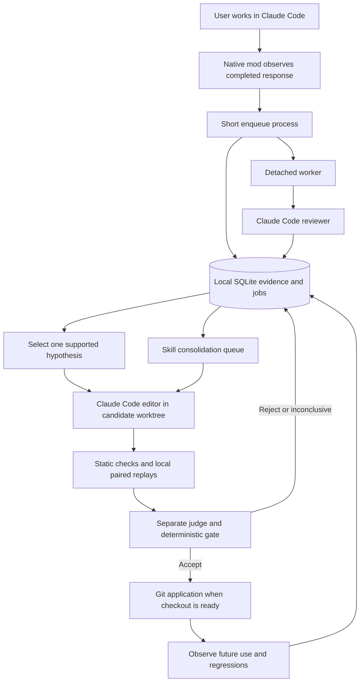
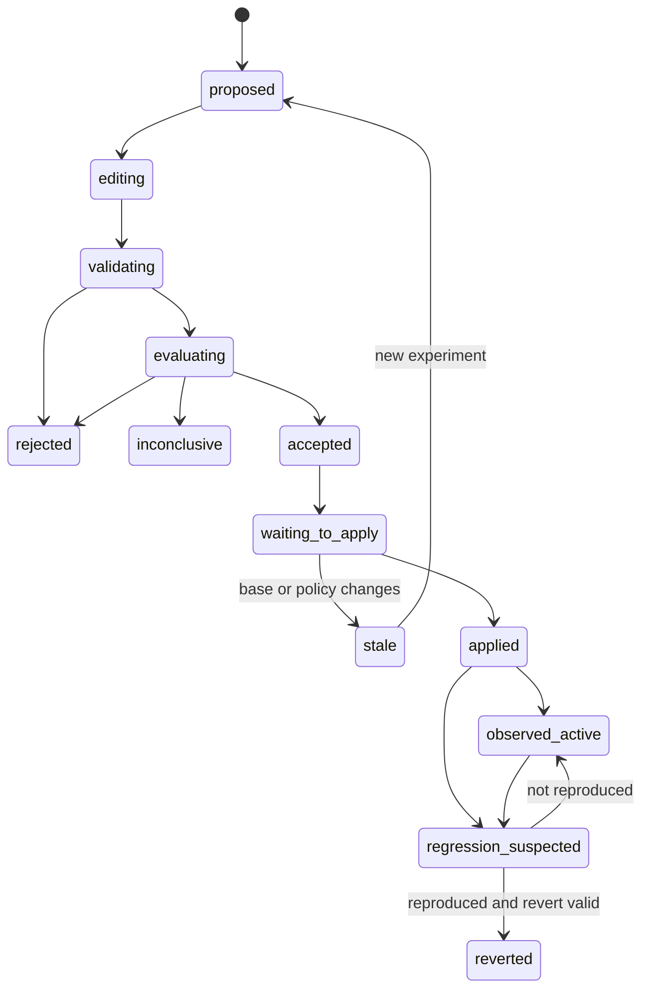

# Architecture

This is a proposed design, not an implemented system. The implementation baseline is Claude Code CLI 2.1.306 on macOS and Linux. Native mod APIs are changing; the first work package checks the installed build before relying on these contracts.

## 1. System boundary

Use a small TypeScript mod for lifecycle observation and a Python 3.11+ worker for durable work. Python's standard library provides SQLite, subprocess management, hashing, and file handling. Git is the only harness history mechanism. No separate service installation, server, vector database, or Docker dependency is required.



The mod observes. The worker coordinates. Claude proposes and evaluates evidence. A deterministic gate decides whether all required conditions hold. The authoring model never applies its own work to the user's checkout.

## 2. Native mod integration

Planned package layout:

```text
.claude-plugin/plugin.json
hooks/hooks.json                 # modules: ["./register.ts"]
hooks/register.ts                # literal event registrations
hooks/register.test.ts
continua/                       # Python worker package
prompts/                        # reviewer, author, judge, curator
schemas/                        # data contracts
tests/                          # Python tests and synthetic fixtures
evals/                          # Claude native plugin eval cases
benchmarks/                     # full-harness runner cases and external graders
```

These paths describe the future plugin. They are not present as functioning components in this documentation repository.

Register literal events and use documented mod APIs; do not assume Node APIs are available inside the mod. The [native mod reference](https://code.claude.com/docs/en/plugins/mods/reference) supplies event contracts, while the [mods API](https://code.claude.com/docs/en/plugins/mods/api) supplies session and subprocess access.

| Event | Continua action |
|---|---|
| `classic.SessionStart` | Associate session ID, transcript path, working directory, and lifecycle source; reset capture on clear/resume/branch |
| `turn.start` | Record task text, turn identity, and foreground activity |
| `turn.complete` | Capture the completed top-level episode and enqueue once |
| `skill.prompt` | Record the skill actually supplied, its source/path, and relevant identity |
| `classic.InstructionsLoaded` | Record instruction files observed as loaded |
| `tool.call` | Optionally capture bounded result metadata after `next(e)` returns |
| `session.end` | Best-effort final activity update; do not launch long model work here |

Ignore subagent completions as independent triggers; their useful results can remain evidence in the parent episode. Ignore sessions marked as Continua review, edit, judge, or replay work. Preserve `next(e)` behavior and return values exactly. Capture failures must not turn a successful user response into an error.

Use `classic.SessionStart` for session transitions: native `session.start` alone is insufficient for clear/resume handling. Verify exact event fields against the installed types; use explicit end reasons where available, with a tested compatibility adapter for older abortion fields.

## 3. Capture and durable ingress

Each episode uses the native `(session_id, turn_id)` pair as its deduplication identity. A persisted `lifecycle_id` records initial load/clear/resume segments as metadata; it must not make a redelivered completion look like a new episode. M0 must verify native ID stability across reloads and branches. Recovery without a reliable original turn ID records a capture gap rather than inventing a new identity for possibly duplicated work.

Capture a bounded, immutable input at the completion boundary:

- Current request and relevant prior constraints, with provenance.
- Assistant answer, observed tool results, known test outcomes, end reason, and timing/usage when supplied.
- Repository identity, branch, observed HEAD, dirty-state flags, and harness files observed in the session.
- Coverage metadata: omitted history, truncated fields, unsupported attachments, missing results, and uncertain task boundaries.

Normalized session history is convenient but has a record limit and lacks durable message IDs. Assign episode-local evidence IDs such as `e0001`; store role, type, content, capture position, and optional source byte range. Hashing validates an excerpt's identity; it is not a harness version store. A full transcript path is an input source, not permission to read future appended turns. Any transcript tail read must stop at the recorded completion boundary.

Bound the envelope to 512 KiB before subprocess ingress and the reviewer input to its token budget. Prefer constraints, actual failures, explicit corrections, and outcome evidence. Never silently label a partial record complete. Raw media is out of scope for v1; preserve attachment metadata and an `unsupported_media` flag.

Call a short worker entry point through `$.process.run` using an argument vector and stdin, not a shell string. It validates the envelope, creates the episode and job in one SQLite transaction, then starts or wakes the detached worker. Return the durable job ID. Process startup, normalization, and SQLite contention count toward foreground latency.

If the enqueue acknowledgement is lost, retry the same identity. If ingress exceeds one second or cannot persist, report the error and allow the user's response to finish. Best-effort recovery on the next session start can recover eligible completed boundaries from the known transcript; it must report uncertain gaps rather than fabricate full capture coverage.

## 4. Worker and queue

The worker is a detached, on-demand process. It exits after a short idle period. New ingress, session startup, or `/continua retry` wakes it. It can finish queued work after the parent Claude process closes; no always-on OS daemon is needed initially. Machine shutdown or sleep pauses progress until the next wake.

Use SQLite WAL on a local filesystem, short write transactions, a busy timeout, and bounded retries. A job lease has an expiry and heartbeat. Never hold a database transaction across a model call, Git operation, or test run. See [SQLite WAL](https://www.sqlite.org/wal.html) for the concurrency constraints.

Job types: `review`, `propose`, `evaluate`, `consolidate`, `apply`, `verify_active`, and `reproduce_regression`. Lease work atomically; reclaim expired leases. A repository worker lock prevents simultaneous experiments. A small machine-level lock limits experiment concurrency across repositories without creating a second evidence database.

Prioritize capture/reviews, then pending applications with valid results, then candidate experiments, then broad consolidation. A long model process is not preempted merely because a new review arrives; after its current bounded step, check the review queue. Two long-running candidates cannot coexist for the same branch.

Retry transient model/network failures with bounded exponential backoff and jitter. Authentication failures, usage limits, missing commands, policy conflicts, and missing fixtures have separate blocked states. Budget exhaustion leaves work pending. Do not translate infrastructure failure into a poor agent rating.

Foreground activity is separate from worker job leases. Refresh it on observed turn/tool activity and clear it on completion or confirmed process exit. An expired activity timestamp alone is insufficient evidence that a long model call has finished. Unknown liveness defers application until a later lifecycle event or process check resolves it.

Exactly-once external model execution is not promised. An interrupted request may have consumed tokens. Each attempt has a call ID and accounting record; automatic Git application is idempotent even when model calls are retried.

## 5. Local storage

Default data directory: `~/.claude/continua/<project-id>/`, with restrictive filesystem permissions. Compute project identity from the canonical Git common-directory path. Worktrees of the same repository share evidence, but branch and base commit scope each experiment. Do not use a remote URL containing credentials as an identifier. Moving the repository requires explicit reassociation or a new local evidence store.

| Table | Main purpose and fields |
|---|---|
| `episodes` | Session/turn identity, task grouping, boundary time, intent, end reason, capture coverage, observed commit, loaded-harness evidence |
| `evidence` | Episode-local IDs, redacted excerpts, type, provenance, retention deadline |
| `reviews` | Episode, dimensions, strengths, failures, uncertainty, evidence IDs, actual reviewer model, rubric commit |
| `candidates` | Hypothesis, originating reviews, scope, base/candidate/applied/reverted Git SHAs, status, rejection reason |
| `evaluation_runs` | Candidate, case, arm, trial, environment, actual model, output artifacts, deterministic results, judge result, cost/time |
| `skill_events` | Skill path/source, load/invocation/edit/merge events, links to observed outcomes |
| `jobs` | Type, deduplication key, state, lease, attempts, next eligible time, error classification |
| `model_calls` | Job/attempt identity, requested/resolved model, limits, reported usage, accounting uncertainty |

Store small structured records directly; bounded trace blobs and temporary outputs may be local files referenced by the DB. Treat these as evidence retention, not historical harness copies. Do not store a second sequence of harness versions, snapshot trees, or patch archives. Use `git show`, `git diff`, and `git log` for file history.

Candidate branches can retain rejected commits temporarily, then be deleted under a retention rule. Record when a referenced rejected commit is no longer locally available. Applied commits remain in the project's normal history. Keep accepted case fixtures in Git; store runtime evaluation artifacts outside the target repository.

Ordinary review/run detail can expire under the retention policy. Retain small applied/reverted decision records, confirmed regression signatures, and links to active protected cases while the project remains enrolled. Expiring transcript evidence must not silently remove a regression test or make a rejected failure pattern appear new. Explicit project-data deletion can remove these records as well.

Use exact paths, categories, normalized failure signatures, and SQLite text search before adding semantic retrieval. Recurrence counts should use independent tasks, not repeated turns in one conversation. Unverified historical reviews can suggest a hypothesis but cannot become ground truth by repetition.

## 6. Claude Code adapter

Define a small interface for `review`, `edit`, and `judge`, returning structured results plus usage and errors. The initial implementation launches Claude Code; future providers can implement this interface without changing the queue or gate.

Reviewer and judge run in a neutral working directory with explicit system instructions, a JSON output schema, no tools, no session persistence, and safe mode. Feed the selected trace and harness excerpts as delimited data. The author runs separately in a candidate worktree, also with customizations disabled, but with only the file-editing tools needed for approved paths. It receives the harness content explicitly and does not execute candidate hooks while editing.

CLI capabilities such as `--safe-mode`, `--tools`, `--json-schema`, and `--no-session-persistence` were checked against 2.1.306. Verify their combination in the compatibility spike. Safe mode is appropriate for independent review; it is **not** appropriate for a full-harness replay because that replay must load the harness being evaluated.

Subscription authentication uses the user's supported Claude Code sign-in. For an isolated replay configuration, an explicitly provisioned `CLAUDE_CODE_OAUTH_TOKEN` from `claude setup-token` is a documented option. Do not extract keychain credentials or store tokens in the DB. Bare mode is unsuitable for this default because it does not use subscription OAuth. Validate the effective authentication source so an inherited API key does not silently change billing. [Claude Code authentication](https://code.claude.com/docs/en/authentication)

Never interpolate prompts into shell commands. Use stdin and argument arrays. A zero process exit code does not guarantee a valid model result: require structured output, valid references, expected fields, and a complete run. Missing model identity makes a paired comparison non-promotable. Alias changes require fresh baseline comparisons and judge calibration.

## 7. Candidate lifecycle and Git application



1. Select a clean committed base. If the source checkout has relevant uncommitted harness edits, defer candidate generation; do not create a hidden commit of the user's work.
2. Create `continua/<candidate-id>` and a disposable worktree with ordinary Git commands.
3. Give the author one supported hypothesis and the allowed paths. Inspect the resulting diff, file types, symlinks, config fields, executable/dependency changes, and support-file links.
4. Commit the candidate with a unique `Continua-Candidate` trailer. Tests compare this commit with the exact base.
5. Gate the candidate using the evaluation policy below. Save the decision and all run references.
6. Before application, acquire the application lock and recheck branch, HEAD, scope/policy, evaluator identity, clean index/worktree, and known foreground activity. A change to any prerequisite invalidates or defers application.
7. Apply the single evaluated commit using a normal fast-forward merge when HEAD still equals its base. Never auto-rebase an evaluated candidate onto a new base. A changed base needs a new comparison.
8. Record the resulting commit after verifying the Git state. On a crash between Git application and DB update, reconcile the unique commit trailer and actual ancestry before retrying.

Git worktrees share repository metadata; they are not independent repositories or sandboxes. Replay workers must not receive writable access to the coordinator's Git control files through tool permissions, and trusted test commands must not alter branches/refs. [Git worktree documentation](https://git-scm.com/docs/git-worktree.html)

The worker lock coordinates Continua processes. It cannot lock an unrelated editor or arbitrary shell process. Repeat checks immediately before application and verify the result afterward. Do not claim atomic exclusion of all external edits. Unexpected state enters recovery and suspends further application; never overwrite files to repair it. A short quiet interval may delay **application**, but never delays the review trigger.

If a known regression is reproduced, prepare `git revert` in an isolated branch, validate it, and apply with the same checks. If later edits conflict, leave a proposed revert and explain the blocker. No hard resets, hidden stashes, or automatic target-repository pushes.

## 8. Full-harness local replay

The native `claude plugin eval` runner deliberately omits project-level customizations. Use it for Continua's packaged plugin behavior. A separate replay runner must reconstruct and load the entire project harness for candidate comparisons. [Official plugin eval isolation](https://code.claude.com/docs/en/plugin-evals#how-runs-are-isolated)

For each case, materialize identical task files and distinct baseline/candidate harness commits in disposable worktrees. The task fixture identifies its source commit; the runner overlays only the nominated harness paths from each arm. Record both identities. This avoids comparing a past trajectory on old application code with a fresh run on new code.

Use a neutral, dedicated Claude configuration for replay. Supply only the enrolled project harness, selected installed-plugin dependencies, approved tool/MCP fixtures, and common managed constraints. Exclude personal memory and unrelated user plugins. Freeze the two arms' actual model, CLI build, toolchain, task limits, dependencies, environment, and test commands. If an external dependency cannot be pinned or mocked, report limited reproducibility and restrict automatic promotion.

Local replay runs with the user's machine access. Its containment measures are explicit path and command allowlists, neutral configuration, stripped unrelated environment variables, finite processes/timeouts, mocked side effects, and temporary worktrees. These measures reduce accidental interference; they are not an adversarial security boundary. Do not run untrusted downloaded hooks or install new dependencies as part of a candidate test without an enrolled policy covering them.

Candidate hooks and scripts execute only in the evaluation phase, never during capture, review, or editing. Tests requiring real credentials, writes to production services, arbitrary network access, or unknown executables remain pending until an appropriate adapter and execution policy exists. Use test servers/mocks for MCP changes. Protect graders outside the editable worktree and run their checks from the coordinator; malicious local code is still outside the supported threat model.

## 9. Consolidation and effective activation

Each review checks related existing skills. Queue a broader sweep after the PRD thresholds. The curator proposes one merge/update at a time, with a coverage map from original triggers and procedures to the result. The author edits; validators check references and path changes; the same replay gate decides. No low-use deletion heuristic runs independently of evidence.

A merged skill preserves named exceptions and support files, and its description must still retrieve it for each original task. Maintain DB links from old skill paths to the applied merge commit for interpretation. Git retains the old contents; do not build a second archive directory of obsolete skill bodies.

Applied content may not be immediately active in an existing conversation. Track observed instruction/skill loads and reload requirements. Do not force compaction, clear, or restart the user's conversation. Attribute a future result to a new harness only when the relevant context was observed as loaded; otherwise mark exposure unknown. Exact reload behavior belongs in compatibility tests against [skills](https://code.claude.com/docs/en/skills) and [memory](https://code.claude.com/docs/en/memory) documentation.

## 10. Operational visibility

Keep a quiet status line and a `/continua` command surface. Show latest review, queue state, experiment progress, accepted changes, deferred activation, actual Git diff, measured usage, and unresolved coverage. Notifications are for applied changes and actionable failures, not every routine review.

Retain redacted evidence locally with bounded sizes and expiry. Purging evidence must leave reviews visibly unverifiable where their supporting excerpts were deleted. Private evidence never enters the public plugin repository automatically. Exporting fixtures requires separate explicit selection and redaction.
