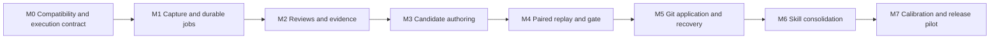

# Implementation plan

This plan builds the product described in the [PRD](PRD.md). The current repository is a documentation deliverable. No runtime milestone below is complete yet.

## 1. Delivery sequence

Build one vertical path first: capture a synthetic turn, review it through a fake CLI, produce a small candidate in Git, reject a bad change, apply a good change, and recover from a crash. Add live model calls only once that path is observable and testable.

Rough planning range: **25–40 engineer-days** for a tested experimental release, assuming one engineer familiar with Claude plugins and Python. Live judge calibration, labeling, compatibility problems, and model usage limits may extend elapsed time. Estimate again after M0. A report-only preview can ship after M2; automatic application cannot ship before M5 and the required calibration/gate tests.

## 2. Work packages

### M0 — Verify the platform and local execution contract

**Estimate:** 2–3 days. **Dependencies:** none.

Deliverables:

- Minimal native mod with a manifest and literal lifecycle handlers.
- Compatibility probe for session transitions, top-level turn IDs, skill events, instruction-load observation, and middleware return behavior on Claude Code 2.1.306.
- A short ingress process that starts a detached Python worker and returns promptly.
- Tested CLI profiles for a tool-free reviewer, scoped editor, and full-harness replay, using supported subscription authentication.
- A local replay profile demonstrating which project and user customizations load. Confirm that the full harness is active and Autotune cannot recursively learn from the run.
- A field-level editable/executable policy for project settings and MCP configuration.

Exit criteria:

1. Two normal responses and a resume/clear sequence produce the intended boundaries in a temporary project.
2. Parent exit does not terminate already queued work or leave ingress waiting on inherited output pipes.
3. Reviewer safe mode does not load a test `CLAUDE.md`; replay does load the nominated one.
4. Subscription authentication works in the neutral profile without copying keychain material or enabling API billing accidentally.
5. A mocked changed hook runs only in a controlled replay, never during review or editing.

If the required native event contract fails, document the specific incompatibility. A classic-hook adapter may be a temporary implementation option, but it must preserve per-response semantics and deduplication. Do not silently reduce the product to session-end reviews.

### M1 — Capture, normalize, and persist jobs

**Estimate:** 3–5 days. **Dependencies:** M0.

Deliverables:

- Bounded episode normalizer, evidence IDs, coverage flags, and recursion exclusion.
- SQLite tables, transactional ingress, deduplication, leases, and retry classifications.
- On-demand worker lifecycle, repository lock, and per-machine experiment lock.
- Redaction, retention, disk limits, and explicit capture-error reporting.
- Read-only status command and structured logs with no secret payloads.

Exit criteria: duplicate/race tests pass; crash and acknowledgement-loss recovery pass; 10,000 synthetic events produce the expected unique record count; capture p95/p99 targets are measured; long malformed input stays within memory/time limits. A benchmark miss must be reported and addressed, not hidden by dropping events.

### M2 — Evidence-based reviews

**Estimate:** 3–4 days. **Dependencies:** M1.

Deliverables:

- Claude CLI adapter with argument arrays, JSON schema validation, timeouts, process cleanup, usage accounting, and a fake-CLI equivalent.
- Review prompt and 0–4/null rubric with evidence references.
- Cross-episode lookup by task family, affected path, and failure signature.
- Strength/no-op/uncertainty results and an inspectable review view.
- Budget reservation, retry/backoff, and explicit blocked-budget/auth states.

Exit criteria: missing outcome causes abstention; fictitious evidence is rejected; a transcript injection cannot modify the reviewer instructions; all five dimensions are stored correctly; input truncation is visible. Report-only preview can be tested on selected local work after an initial labeled calibration set passes.

### M3 — Scoped hypotheses and candidate authoring

**Estimate:** 3–4 days. **Dependencies:** M2.

Deliverables:

- Candidate selection from direct corrections, verified failures, or recurring independent tasks.
- Prior-attempt lookup to avoid repeating a rejected patch without new evidence.
- Git branch/worktree management and one-candidate scheduling.
- Separate Claude Code author with explicit allowed paths and no candidate execution.
- Diff, file type, symlink, executable, configuration-field, and protected-path validators.
- Hypothesis record with expected effect and required eval coverage.

Exit criteria: a simple instruction/skill patch is authored in the worktree; an unrelated source edit and evaluator edit fail validation; a bad candidate never changes the user checkout; a no-op review does not create a branch. All candidate commit trailers are unique and recoverable.

### M4 — Full-harness replay and promotion gate

**Estimate:** 5–7 days. **Dependencies:** M3; case fixtures and calibration labels can be prepared earlier.

Deliverables:

- Local paired runner with separate baseline/candidate worktrees, identical task fixtures, explicit customization loading, and frozen run metadata.
- Outcome graders outside candidate-editable paths, with mocked external side effects.
- Case manifest contract, affected-suite selection, trial scheduling, and bounded retries.
- Blinded order-swapped judge adapter and deterministic acceptance function.
- Infrastructure-error classification, complete result artifacts, and cost/time accounting.
- Native plugin eval suite for packaged behavior, separate from the full-harness runner.

Exit criteria: baseline and candidate run against the same fixture; a targeted useful change meets its declared effect; a removed-verification change is rejected; a broken mock or model mismatch is inconclusive; exhausted budget leaves work pending; a project-level instruction change actually affects the replay. No automatic application yet.

### M5 — Application, activation tracking, and recovery

**Estimate:** 3–5 days. **Dependencies:** M4 and gate calibration.

Deliverables:

- Recheck clean state, branch, base, policy, evaluator, and known foreground activity before Git application.
- Fast-forward application of the evaluated candidate and commit-to-DB reconciliation.
- Distinct applied/observed-active states and reload guidance without forced conversation changes.
- Regression reproduction, tested Git revert, conflict handling, and pause/cancel controls.
- User-visible summaries with evidence links, Git diff, and exact defer reasons.

Exit criteria: kill the worker at each application boundary and recover without a duplicate commit; dirty user work remains byte-for-byte unchanged; moved HEAD invalidates evaluation; a conflicting revert stops safely; the new instructions are not credited before observed exposure. The known race with unrelated editors is documented and does not trigger automatic overwrites.

### M6 — Continual skill consolidation

**Estimate:** 3–5 days. **Dependencies:** M5.

Deliverables:

- Skill inventory and separate load/invocation/outcome observations.
- Local overlap checks and configured broader sweep scheduling.
- Curator prompt that proposes merges/updates with trigger and procedure coverage maps.
- Support-file moves and link validation; protection for pinned and rare critical skills.
- Consolidation-specific negative-trigger and exception-preservation cases.

Exit criteria: merge two overlapping skills while preserving distinct edge cases and scripts; reject a merge that looks concise but drops an exception; avoid pruning a zero-use critical skill; route every accepted consolidation through the ordinary Git/eval path. No separate skill history mechanism.

### M7 — Calibration, operational pilot, and experimental release

**Estimate:** 3–7 days plus observation and labeling time. **Dependencies:** M1–M6.

Deliverables:

- Labeled judge set, harmful-change mutation set, and clearly separated promotion/holdout cases.
- Mechanical CI on macOS/Linux, protected paid-test jobs, plugin validation, and install/uninstall checks.
- A report-only observation period followed by narrowly scoped automatic operation on a test repository.
- Paired effectiveness pilot and a cost-based plan for the larger held-out study.
- Sanitized release evidence, known limitations, recovery instructions, and user documentation.

Exit criteria: mechanics and gate release thresholds pass; one successful applied improvement and one prevented regression are reproducible; retention and export behavior are checked; total usage is reported; the release is labeled experimental unless broader evidence supports a stronger claim.

## 3. Component boundaries for implementation

| Component | Responsibility | Must not do |
|---|---|---|
| `hooks/register.ts` | Observe events, capture bounded context, enqueue, show status | Run reviews or edit the project |
| `capture.py` | Normalize and redact episodes; assign evidence IDs | Infer missing outcomes as facts |
| `store.py` / `queue.py` | Transactions, leases, deduplication, retention | Hold transactions during external work |
| `claude_cli.py` | Model subprocess protocol and accounting | Apply candidates or decide acceptance |
| `review.py` | Validate reviews and propose supported hypotheses | Treat ratings as causal proof |
| `scope.py` | Paths, config fields, executable policy | Let candidate text widen its own scope |
| `git_ops.py` | Worktrees, commits, application, reconciliation, revert | Stash/reset user work |
| `replay.py` | Matched arms, fixtures, commands, environment | Use native plugin isolation as a project replay |
| `graders.py` / `gate.py` | External checks and deterministic decisions | Accept missing or contradictory evidence |
| `skills.py` | Inventory, consolidation coverage, support-file validation | Delete solely from usage counters |
| `cli.py` | Status, inspection, controls, setup | Publish private evidence automatically |

Keep policy and acceptance functions pure where possible. Inject clock, process runner, Git adapter, and model adapter so mechanics can run without credentials. SQLite and Git integration tests remain real local tests; model calls use a scripted fake until explicit paid validation.

## 4. Required initial fixtures

Build these before broad autonomous editing:

| Fixture | What it verifies |
|---|---|
| Generated-file mistake | Instruction changes correct the source workflow |
| False test-success claim | Judge checks actual exit/result artifacts |
| Missing final outcome | Reviewer uses unknown/partial status |
| Duplicate stop and resumed session | Capture identity and recovery |
| Dirty checkout and moved HEAD | User-work preservation and stale comparisons |
| Two skills with different exceptions | Consolidation retains behavior |
| Skill with relative script/reference paths | Support files survive a merge |
| Hook that suppresses a test failure | Gate rejects an apparently cleaner transcript |
| Tool config with a new executable | Scope expansion is detected |
| Crash after Git succeeds | DB reconciliation prevents duplicate application |

All public fixtures are synthetic or explicitly licensed. Local private sessions can inspire a case, but are not exported by default.

## 5. Rollout and decision points

Start with report-only enrollment to establish capture and judging behavior. Enable automatic edits on explicit harness paths after a valid local replay suite exists. Expand from instructions/skill text to enrolled executable components once their fixture and command policies pass. This is staged implementation, not a permanent restriction to text-only learning.

If judge calibration fails, improve labels and rubric before increasing model budget. If reliable outcomes cannot be checked, keep proposals advisory. If held-out improvement disappears at matched compute, retain the useful evidence/consolidation features and reconsider automatic broad harness search. If local replay causes unacceptable interference, revisit isolation as a later product choice; v1 retains the user's selected local-only design.

## 6. Definition of done for each change

A product change includes its relevant contract updates, meaningful unit/integration tests, explicit failure behavior, and sanitized user-facing evidence. No unit test should merely repeat the code's implementation. A new model-dependent behavior additionally needs a frozen fixture, independently justified grading, budget accounting, and actual results before being described as validated.

Git records product development and target harness changes. No work package introduces a parallel versioning subsystem.
