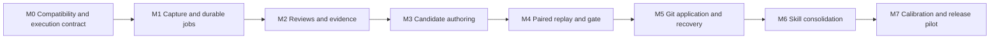

# Implementation plan

This plan builds the product described in the [PRD](PRD.md). Milestones M0 to M7 are built and tested with a
scripted fake Claude CLI. Live evidence is limited to a few manual checks on Claude Code 2.1.306. Section 2 gives
the status of every exit criterion, and section 3 lists the open items. The release is experimental.

## How exit criteria are marked

- **passed (fake CLI): `<test>`**: a deterministic test passes with the fake Claude CLI (`tests/fake_claude.py`),
  real SQLite, real Git repositories and real subprocesses. Test names are unittest ids, run with
  `python3 -m unittest <id>`. No model is called.
- **passed (mocked mod engine): `<test>`**: a test in `hooks/register.test.ts` passes under `claude plugin test .`,
  which drives the mod with a mocked engine.
- **passed live**: checked by hand against the real Claude Code CLI on 21 October 2026. There is no reusable probe
  script for these checks.
- **planned**: not done, with the reason.

Test counts on the development machine (macOS): 879 Python tests pass on Python 3.15.0 and on 3.11.16;
`claude plugin test .` passes 28 of 28. See [release evidence](RELEASE_EVIDENCE.md).

## 1. Delivery sequence

Build one vertical path first: capture a synthetic turn, review it through a fake CLI, produce a small candidate
in Git, reject a bad change, apply a good change, and recover from a crash. Add live model calls only once that
path is observable and testable.

The original planning range was 25 to 40 engineer-days for a tested experimental release. Live judge calibration,
labelling, the observation period and model usage limits are still ahead and are not covered by the code work.
A report-only preview needs an initial labelled calibration set first (M2). Automatic application is built but off
by default (`automatic_apply: false`) until the calibration and gate evidence in M7 exists.

## 2. Milestones

| Milestone | Status |
|---|---|
| M0 Platform and execution contract | Built. Criteria 2 and 3 passed; 1, 4 and 5 passed with fakes or partly live, interactive checks planned |
| M1 Capture and durable jobs | Built. All criteria passed (fake CLI); latency decision recorded below |
| M2 Reviews and evidence | Built. All mechanical criteria passed (fake CLI); report-only preview planned (needs labels) |
| M3 Candidate authoring | Built. All criteria passed (fake CLI) |
| M4 Paired replay and gate | Built. All criteria passed (fake CLI); live replay planned |
| M5 Application and recovery | Built. All criteria passed (fake CLI) |
| M6 Skill consolidation | Built. All criteria passed (fake CLI) |
| M7 Calibration and release | Tooling built. Mechanics passed locally; simulated gate thresholds passed; calibration, observation period, pilot and held-out study planned |

### M0: Verify the platform and local execution contract

Status: built. The mod (`hooks/register.ts`), ingress, detached worker, the three CLI profiles in
`autotune/claude_cli.py` and the field-level policy for project settings and MCP configuration
(`field_rules` in `.autotune.json`, enforced by `autotune/scope.py`) exist.

Deliverables:

- Minimal native mod with a manifest and literal lifecycle handlers.
- Compatibility probe for session transitions, top-level turn IDs, skill events, instruction-load observation, and
  middleware return behavior on Claude Code 2.1.306.
- A short ingress process that starts a detached Python worker and returns promptly.
- Tested CLI profiles for a tool-free reviewer, scoped editor, and full-harness replay, using supported subscription
  authentication.
- A local replay profile demonstrating which project and user customizations load.
- A field-level editable/executable policy for project settings and MCP configuration.

Live run on 21 October 2026 (`claude -p --plugin-dir <repo>` in a temporary enrolled repository): one episode per
completed turn with the native session and turn IDs, request, answer, model, duration, transcript path and HEAD;
the detached worker started; `foreground_activity` ended as `ended` after the session closed; with
`AUTOTUNE_ORIGIN=replay` no episode was created; the mod's ingress calls took about 90 ms each.
`classic.InstructionsLoaded` did not reach the mod under `-p`, so that episode recorded `exposure: unknown`.

Exit criteria:

1. Two normal responses and a resume/clear sequence produce the intended boundaries in a temporary project.
   - passed live for one-episode-per-turn under `claude -p` (the run above).
   - passed (mocked mod engine): "a main-loop turn sends one turn_complete envelope and keeps the answer",
     "a clear starts a new lifecycle and resets loaded instructions", "a completion with no observed start is
     marked missing_turn_start", "a subagent turn sends nothing".
   - planned: two interactive responses followed by a clear and a resume against the real CLI. It needs an
     interactive session, which has not been run.
2. Parent exit does not terminate already queued work or leave ingress waiting on inherited output pipes.
   - passed (fake CLI): `tests.test_integration_process.ParentExitTest.test_queued_work_survives_parent_exit`,
     `tests.test_integration_process.DetachTest.test_ingress_returns_while_worker_stays_alive`.
   - passed live: the worker kept running after the `-p` session exited.
3. Reviewer safe mode does not load a test `CLAUDE.md`; replay does load the nominated one.
   - passed live: a project `CLAUDE.md` marker was not visible under `--safe-mode`, and was visible under
     `--setting-sources project --strict-mcp-config`.
   - passed (fake CLI): `tests.test_adapter_claude_cli.BuildArgvTests.test_reviewer_profile_is_tool_less_and_safe`,
     `tests.test_adapter_claude_cli.BuildArgvTests.test_replay_profile`,
     `tests.test_evaluate.PairedReplayTest.test_project_instruction_change_reaches_the_replay`.
4. Subscription authentication works in the neutral profile without copying keychain material or enabling API
   billing accidentally.
   - passed live: `claude auth status --json` reports `authMethod: claude.ai` in the normal config dir and
     `loggedIn: false` under a fresh `CLAUDE_CONFIG_DIR`, so Autotune uses the normal config dir and gets
     neutrality from flags.
   - passed (fake CLI): `tests.test_adapter_claude_cli.ChildEnvTests.test_strips_provider_and_parent_session_variables`,
     `tests.test_adapter_claude_cli.AdapterTests.test_auth_failure_blocks_before_any_model_call_row`,
     `tests.test_adapter_claude_cli.AdapterTests.test_api_key_auth_allowed_when_configured`.
   - passed live: reviewer, author and replay calls through the adapter against the real CLI with haiku, in the
     live vertical slice (see docs/RELEASE_EVIDENCE.md).
5. A mocked changed hook runs only in a controlled replay, never during review or editing.
   - passed (fake CLI): reviewer and author argv carry `--safe-mode`
     (`tests.test_adapter_claude_cli.BuildArgvTests.test_reviewer_profile_is_tool_less_and_safe`,
     `tests.test_adapter_claude_cli.BuildArgvTests.test_author_profile_removes_dangerous_tools`); Git runs with
     hooks disabled (`tests.test_git_ops.WorktreeTest.test_create_worktree_runs_no_hooks_and_leaves_checkout_untouched`,
     `tests.test_apply.GitOpsApplyTest.test_merge_ff_only_runs_no_hooks`); a new hook command is a scope violation
     (`tests.test_scope.FieldRulesTest.test_new_hook_command_without_executable_policy_fails`).
   - planned: a live check that a changed project hook fires in a replay workspace and not in a review. Not run.

### M1: Capture, normalize, and persist jobs

Status: built, including the items that were open after the first pass: disk limits and log rotation
(`autotune/diskcap.py`), cancelling a running job, and resending failed envelopes on a later turn.

Deliverables:

- Bounded episode normalizer, evidence IDs, coverage flags, and recursion exclusion.
- SQLite tables, transactional ingress, deduplication, leases, and retry classifications.
- On-demand worker lifecycle, repository lock, and per-machine experiment lock.
- Redaction, retention, disk limits, and explicit capture-error reporting.
- Read-only status command and structured logs with no secret payloads.

Exit criteria:

- Duplicate and race tests pass.
  - passed (fake CLI): `tests.test_integration_process.RaceTest.test_concurrent_identical_envelopes_make_one_episode`,
    `tests.test_store_ingest.IngestTest.test_duplicate_returns_same_ids`,
    `tests.test_store_queue.LeaseTest.test_lease_exclusive_between_connections`.
- Crash and acknowledgement-loss recovery pass.
  - passed (fake CLI): `tests.test_integration_crash.CrashRecoveryTest.test_killed_worker_job_is_reclaimed_and_completed_once`,
    `tests.test_integration_crash.LostWakeupTest.test_job_enqueued_during_idle_exit_is_still_processed`,
    `tests.test_integration_process.AckLossTest.test_resend_returns_duplicate_with_same_ids`.
  - passed (mocked mod engine): "a lost acknowledgement is resent once and the second send succeeds",
    "a failed turn is resent oldest first at the next turn start, before its own envelope".
- 10,000 synthetic events produce the expected unique record count.
  - passed (fake CLI): `tests.test_integration_volume.VolumeTest.test_expected_unique_episode_and_job_counts`.
- Capture p95 and p99 targets are measured.
  - passed (fake CLI): `tests.test_integration_benchmark.CaptureLatencyBenchmark.test_sequential_ingress_latency`,
    `tests.test_integration_benchmark.TurnLatencyBenchmark.test_turn_start_plus_large_turn_complete_with_worker`.
  - Latency decision: the 150 ms target applies to each blocking hook call; both pass (turn_start and
    turn_complete each have p95 under 150 ms). The per-turn sum of 196 ms p95 is reported and accepted for the
    experimental release. A later Python 3.15 run measured 199.9 ms, and a Python 3.11 run on a busy machine
    218.4 ms with each call still under 150 ms; the figures are in the release evidence.
- Long malformed input stays within memory and time limits.
  - passed (fake CLI): `tests.test_integration_bounds.BoundedInputTest` (10 MB stdin, peak memory, invalid UTF-8,
    deep nesting, unterminated JSON, oversized tool calls).
- Disk limits, log rotation and fallback capture errors.
  - passed (fake CLI): `tests.test_core_diskcap`, `tests.test_runtime_ingress_diskcap.DiskCapIngressTest`,
    `tests.test_runtime_worker.LogRotationTest`, `tests.test_runtime_worker.DiskCapWorkerTest.test_worker_enforces_the_cap_at_start`.
- Cancelling a running job.
  - passed (fake CLI): `tests.test_runtime_worker.CancelRunningTest`, `tests.test_runtime_cli.ControlTest.test_cancel_running_job_requests_a_stop`.

### M2: Evidence-based reviews

Status: built (`autotune/review.py`, `prompts/reviewer.md`, `schemas/review.schema.json`, the adapter and budget).

Deliverables:

- Claude CLI adapter with argument arrays, JSON schema validation, timeouts, process cleanup, usage accounting, and
  a fake-CLI equivalent.
- Review prompt and 0 to 4/null rubric with evidence references.
- Cross-episode lookup by task family, affected path, and failure signature.
- Strength/no-op/uncertainty results and an inspectable review view.
- Budget reservation, retry/backoff, and explicit blocked-budget/auth states.

Exit criteria:

- Missing outcome causes abstention.
  - passed (fake CLI): `tests.test_review.ReviewHandlerTests.test_missing_outcome_forces_abstention`,
    `tests.test_review.ReviewHandlerTests.test_unsent_answer_forces_abstention`.
- Fictitious evidence is rejected.
  - passed (fake CLI): `tests.test_review.ReviewHandlerTests.test_fictitious_evidence_rejected_after_one_repair`,
    `tests.test_e2e_cycle1.CycleOneCase.test_fictitious_evidence_id_fails_after_one_repair`.
- A transcript injection cannot modify the reviewer instructions.
  - passed (fake CLI): `tests.test_review.ReviewHandlerTests.test_prompt_injection_stays_inside_json_data`.
- All five dimensions are stored correctly.
  - passed (fake CLI): `tests.test_review.ReviewHandlerTests.test_valid_review_round_trips_all_dimensions`.
- Input truncation is visible.
  - passed (fake CLI): `tests.test_review.ReviewHandlerTests.test_truncation_visible_in_row_and_format`.
- Budget and authentication states.
  - passed (fake CLI): `tests.test_review.ReviewHandlerTests.test_budget_exhaustion_blocks`,
    `tests.test_review.ReviewHandlerTests.test_auth_failure_blocks_before_any_call`,
    `tests.test_adapter_budget`.
- Report-only preview on selected local work after an initial labelled calibration set passes.
  - planned: no human-labelled calibration set exists (M7).

### M3: Scoped hypotheses and candidate authoring

Status: built (`autotune/propose.py`, `autotune/scope.py`, `autotune/git_ops.py`, `prompts/author.md`).

Deliverables:

- Candidate selection from direct corrections, verified failures, or recurring independent tasks.
- Prior-attempt lookup to avoid repeating a rejected patch without new evidence.
- Git branch/worktree management and one-candidate scheduling.
- Separate Claude Code author with explicit allowed paths and no candidate execution.
- Diff, file type, symlink, executable, configuration-field, and protected-path validators.
- Hypothesis record with expected effect and required eval coverage.

Exit criteria:

- A simple instruction or skill patch is authored in the worktree.
  - passed (fake CLI): `tests.test_propose.AuthoringTest.test_claude_md_patch_is_committed_with_recoverable_trailer`,
    `tests.test_propose.AuthoringTest.test_skill_patch_is_a_skill_candidate`,
    `tests.test_e2e_cycle1.CycleOneCase.test_turn_is_reviewed_and_a_candidate_is_authored`.
- An unrelated source edit and an evaluator edit fail validation.
  - passed (fake CLI): `tests.test_propose.AuthoringTest.test_unrelated_source_edit_fails_validation_and_leaves_no_branch`,
    `tests.test_propose.AuthoringTest.test_evaluator_edit_is_a_scope_violation`,
    `tests.test_e2e_cycle1.CycleOneCase.test_source_and_evaluator_edit_is_rejected_as_scope_violation`.
- A bad candidate never changes the user checkout.
  - passed (fake CLI): `tests.test_propose.FailureTest.test_author_write_into_the_user_checkout_rejects_the_candidate`;
    every `tests.test_propose` test also compares a snapshot of the checkout, index and HEAD before and after.
- A no-op review does not create a branch.
  - passed (fake CLI): `tests.test_propose.SelectionTest.test_no_change_review_creates_no_job_and_no_branch`.
- All candidate commit trailers are unique and recoverable.
  - passed (fake CLI): `tests.test_propose.AuthoringTest.test_claude_md_patch_is_committed_with_recoverable_trailer`,
    `tests.test_git_ops.ChangesAndCommitTest.test_commit_candidate_is_attributed_hookless_and_recoverable`.

### M4: Full-harness replay and promotion gate

Status: built (`autotune/cases.py`, `graders.py`, `replay.py`, `judge.py`, `gate.py`, `evaluate.py`). The native
plugin eval suite is written in `evals/` and has not been run.

Deliverables:

- Local paired runner with separate baseline and candidate workspaces, identical task fixtures, explicit
  customization loading, and frozen run metadata.
- Outcome graders outside candidate-editable paths, with mocked external side effects.
- Case manifest contract, affected-suite selection, trial scheduling, and bounded retries.
- Blinded order-swapped judge adapter and deterministic acceptance function.
- Infrastructure-error classification, complete result artifacts, and cost/time accounting.
- Native plugin eval suite for packaged behavior, separate from the full-harness runner.

Exit criteria:

- Baseline and candidate run against the same fixture.
  - passed (fake CLI): `tests.test_evaluate.PairedReplayTest.test_arms_share_the_fixture_and_differ_in_harness_commit`,
    `tests.test_replay.MaterializeTests.test_same_fixture_distinct_harness`.
- A targeted useful change meets its declared effect.
  - passed (fake CLI): `tests.test_evaluate.GateOutcomeTest.test_useful_change_meets_its_effect_and_is_accepted`.
- A removed-verification change is rejected.
  - passed (fake CLI): `tests.test_evaluate.GateOutcomeTest.test_removed_verification_is_rejected_by_a_protected_critical_case`.
- A broken mock or model mismatch is inconclusive.
  - passed (fake CLI): `tests.test_evaluate.BrokenGraderTest.test_missing_grader_executable_is_inconclusive`,
    `tests.test_evaluate.GateOutcomeTest.test_model_mismatch_across_arms_is_inconclusive`.
- Exhausted budget leaves work pending.
  - passed (fake CLI): `tests.test_evaluate.BudgetTest.test_exhausted_budget_blocks_with_no_runs_and_full_suite_required`.
- A project-level instruction change actually affects the replay.
  - passed (fake CLI): `tests.test_evaluate.PairedReplayTest.test_project_instruction_change_reaches_the_replay`,
    `tests.test_replay.RunArmTests.test_candidate_harness_changes_the_replay`.
  - planned: the same comparison with real replays. It costs model calls and has not been run.
- Native plugin eval suite.
  - planned: `evals/` is written against the documented format but calls a real model, so it runs only from the
    manual paid workflow, which has not run.

### M5: Application, activation tracking, and recovery

Status: built (`autotune/apply.py`, the apply, verify_active and reproduce_regression jobs, `autotune apply` and
`autotune revert`).

Deliverables:

- Recheck clean state, branch, base, policy, evaluator, and known foreground activity before Git application.
- Fast-forward application of the evaluated candidate and commit-to-DB reconciliation.
- Distinct applied/observed-active states and reload guidance without forced conversation changes.
- Regression reproduction, tested Git revert, conflict handling, and pause/cancel controls.
- User-visible summaries with evidence links, Git diff, and exact defer reasons.

Exit criteria:

- Kill the worker at each application boundary and recover without a duplicate commit.
  - passed (fake CLI): `tests.test_apply_crash.ApplyCrashTest.test_kill_at_each_application_boundary_recovers_without_duplicate`,
    `tests.test_apply_crash.RevertCrashTest.test_kill_at_each_revert_boundary_recovers_without_duplicate`.
- Dirty user work remains byte-for-byte unchanged.
  - passed (fake CLI): `tests.test_apply.ApplyTest.test_dirty_user_work_stays_byte_identical_and_application_waits`.
- Moved HEAD invalidates evaluation.
  - passed (fake CLI): `tests.test_apply.ApplyTest.test_moved_head_makes_the_candidate_stale`.
- A conflicting revert stops safely.
  - passed (fake CLI): `tests.test_apply.RevertTest.test_conflicting_revert_stops_safely`.
- The new instructions are not credited before observed exposure.
  - passed (fake CLI): `tests.test_apply.VerifyActiveTest.test_no_observed_exposure_leaves_the_candidate_applied`,
    `tests.test_apply.VerifyActiveTest.test_unknown_exposure_is_not_credited_even_when_the_path_is_listed`.
- The known race with unrelated editors is documented and does not trigger automatic overwrites.
  - passed (fake CLI): `tests.test_apply.ApplyTest.test_mismatch_after_the_merge_pauses_application`. The race is
    described in [ARCHITECTURE.md](ARCHITECTURE.md) section 7 and the recovery in [OPERATIONS.md](OPERATIONS.md).
- End to end: review, candidate, evaluation, application, regression, reproduction and revert.
  - passed (fake CLI): `tests.test_e2e_cycle2.CycleTwoTest.test_candidate_is_applied_then_reverted_after_a_reproduced_regression`.

### M6: Continual skill consolidation

Status: built (`autotune/skills.py`, `autotune/consolidate.py`, `prompts/curator.md`, the gate consolidation rule).

Deliverables:

- Skill inventory and separate load/invocation/outcome observations.
- Local overlap checks and configured broader sweep scheduling.
- Curator prompt that proposes merges/updates with trigger and procedure coverage maps.
- Support-file moves and link validation; protection for pinned and rare critical skills.
- Consolidation-specific negative-trigger and exception-preservation cases.

Exit criteria:

- Merge two overlapping skills while preserving distinct edge cases and scripts.
  - passed (fake CLI): `tests.test_consolidate.MergeAcceptedTest.test_merge_is_authored_gated_and_applied_as_one_commit`,
    `tests.test_e2e_cycle3.CycleThreeTest.test_overlapping_skills_are_merged_through_the_ordinary_candidate_path`.
- Reject a merge that looks concise but drops an exception.
  - passed (fake CLI): `tests.test_consolidate.MergeRejectedTest.test_coverage_map_missing_an_exception_is_rejected_before_any_edit`,
    `tests.test_consolidate.MergeRejectedTest.test_concise_merge_that_drops_an_exception_is_rejected_by_validate_merge`.
- Avoid pruning a zero-use critical skill.
  - passed (fake CLI): `tests.test_consolidate.CriticalSkillTest.test_zero_use_critical_skill_is_never_a_merge_source`.
- Route every accepted consolidation through the ordinary Git and eval path.
  - passed (fake CLI): `tests.test_consolidate.MergeAcceptedTest.test_merge_is_authored_gated_and_applied_as_one_commit`
    (one commit with the `Autotune-Candidate` trailer), `tests.test_skills.ConsolidationGateTests`.
- No separate skill history mechanism.
  - passed (fake CLI): the same two merge tests assert that the database has only the 11 store tables and that no
    file in the data directory holds the old skill body.

### M7: Calibration, operational pilot, and experimental release

Status: tooling built (`autotune/calibrate.py`, `autotune/stats.py`, `calibration/`, `autotune/mutations.py`,
`benchmarks/`, `autotune/export.py`, `autotune uninstall`, `.github/workflows/`, `evals/`). The human and live
parts are planned.

Deliverables:

- Labelled judge set, harmful-change mutation set, and clearly separated promotion/holdout cases.
- Mechanical CI on macOS/Linux, protected paid-test jobs, plugin validation, and install/uninstall checks.
- A report-only observation period followed by narrowly scoped automatic operation on a test repository.
- Paired effectiveness pilot and a cost-based plan for the larger held-out study.
- Sanitized release evidence, known limitations, recovery instructions, and user documentation.

Exit criteria:

- Mechanics release thresholds pass.
  - passed (fake CLI): the full suite, 879 tests, on Python 3.15.0 and 3.11.16 on macOS. `claude plugin test .`
    28 of 28. `claude plugin validate .` passes with warnings.
  - passed (CI): ubuntu-latest and macos-latest with Python 3.11 and 3.13 all pass on GitHub Actions
    (run 39685368942 on commit b59cfb1, 21 October 2026).
- Gate release thresholds pass.
  - passed (fake CLI): simulated mutation run,
    `tests.test_mutations.SimulatedSuiteTest.test_every_release_criterion_is_met`: 40 harmful with 0 false accepts,
    9 of 9 useful accepted, 0 of 6 neutral reported as improvement. Weakening the gate makes the run fail:
    `tests.test_mutations.WeakenedGateTest`. Simulated runs are not evidence of model behaviour.
  - planned: the live mutation run (`autotune mutations --live --budget-calls N`). Paid; not run.
- Judge calibration thresholds.
  - passed (fake CLI) for the tooling only: `tests.test_calibrate.SeedRunFakeCliTests`,
    `tests.test_calibrate.ThresholdTests`, `tests.test_stats`.
  - planned: 120 independently labelled examples with two human labellers and adjudication. They need people and
    real episodes; none exist. Every threshold reads `insufficient_sample` until then.
- One successful applied improvement and one prevented regression are reproducible.
  - passed (fake CLI): `tests.test_e2e_cycle2.CycleTwoTest.test_candidate_is_applied_then_reverted_after_a_reproduced_regression`,
    `tests.test_evaluate.GateOutcomeTest.test_removed_verification_is_rejected_by_a_protected_critical_case`.
  - planned: the same with live replays.
- Retention and export behavior are checked.
  - passed (fake CLI): `tests.test_store_retention`, `tests.test_cli_cycle3.CandidateBranchRetentionTests`,
    `tests.test_cli_cycle3.ExportTests`.
- Install and uninstall checks.
  - passed live: loading with `--plugin-dir` (the M0 run).
  - passed (fake CLI): `tests.test_cli_cycle3.UninstallTests`.
  - planned: marketplace install. The plugin is not published.
- Total usage is reported.
  - passed (fake CLI): `autotune status` shows model calls per role against budget
    (`tests.test_runtime_cli_review.ReviewCommandTest.test_status_shows_latest_review_and_model_calls`), and the
    calibration report records calls, tokens and cost.
  - planned: usage totals for live runs. None have been recorded.
- A report-only observation period, then narrowly scoped automatic operation on a test repository.
  - planned: needs elapsed time on real work after calibration.
- Paired effectiveness pilot and the held-out study.
  - planned: need real tasks, model budget and the calibration results first. No effectiveness claim is made.
- The release is labelled experimental unless broader evidence supports a stronger claim.
  - done: README and release evidence say experimental.

## 3. Open items

Known limitations (also in [OPERATIONS.md](OPERATIONS.md) and the release evidence):

- A replay whose output exceeds the 8 MiB stdout cap is recorded as `invalid_output`, so a very long replay cannot
  pass.
- A candidate proposed on a detached HEAD has no target branch, and its apply job waits with `branch_changed`
  indefinitely.
- `InstructionsLoaded` does not fire under `claude -p`. `verify_active` therefore needs positive exposure from a
  real interactive episode that loaded a changed path; until one is seen the candidate stays `applied` with
  exposure unknown, and after 14 days it stops checking with reason `exposure_unobserved`. Whether interactive
  sessions deliver the event has not been checked.
- There is no command to clear `git_reconciliation_required`; OPERATIONS.md gives the manual step.
- Worktrees and replay workspaces are not a security boundary.

Evidence not yet collected:

- Human calibration labels (120 examples, two labellers, adjudication).
- The report-only observation period and narrowly scoped automatic operation.
- The paired effectiveness pilot and the held-out study.
- Live mutation run and live plugin eval suite. The live vertical slice ran review, authoring, paired replay and
  the gate (rejected, `target_not_met`); a live accepted candidate followed by apply has not been run.
- Task family matching is exact. The reviewer is now given the families of the committed cases; a reviewer that
  still invents a new slug gives `no_required_cases` (inconclusive), which is safe but wastes the author call.
- `tsc` is not run in CI, because the mod types file
  (`claude-code.d.ts`) is only produced by an interactive session; it runs locally.
- M0 live checks: two interactive responses with clear and resume; a changed project hook firing only in replay.
  There is no reusable compatibility probe script.

Code and contract gaps:

- `experiments_per_day` is validated but not enforced; only the daily call budgets limit experiments.
  `trigger`, `provider` and `replay` are validated as strings and have one supported value each; they change
  nothing.
- In a merge, a symlink or gitlink in a skill directory must survive unchanged under the target. That is checked by
  `validate_merge` after authoring, not before, so such a merge costs one author call before it is rejected.
- The gate mutation set has 40 harmful, 9 useful and 6 neutral mutations; the cycle 3 contract asked for 40, 8
  and 4. The extra ones cover the consolidation target rule.
- The `/autotune` command hint lists commands down to `doctor`; `calibrate`, `mutations`, `export` and
  `uninstall` are passed through and work, but are not listed.
- `/autotune` commands time out after 20 seconds in the mod. `uninstall --yes` can wait up to 20 seconds for the
  worker, so it should be run from a terminal.
- `autotune calibrate` has no `--split` option; the default `calibration` split is always used from the CLI.
- The plugin has no license, author or icon. `claude plugin validate .` still gives README advice about the
  marketplace install line, because `<owner>/<repo>` is a placeholder until the plugin is published.

## 4. Component boundaries

| Component | Responsibility | Must not do |
|---|---|---|
| `hooks/register.ts` | Observe events, capture bounded context, enqueue, show status, run `/autotune` | Run reviews or edit the project |
| `capture.py`, `ingress.py` | Validate, normalize and redact episodes; assign evidence IDs | Infer missing outcomes as facts |
| `store.py`, `queue.py`, `worker.py` | Transactions, leases, deduplication, dispatch | Hold transactions during external work |
| `claude_cli.py`, `budget.py` | Model subprocess protocol and accounting | Apply candidates or decide acceptance |
| `review.py` | Validate reviews; queue proposals and consolidation | Treat ratings as causal proof |
| `propose.py` | Select a supported hypothesis and author one candidate | Write to the user's checkout |
| `scope.py` | Paths, config fields, executable policy | Let candidate text widen its own scope |
| `git_ops.py` | Worktrees, commits, fast-forward, revert, trailers | Stash or reset user work |
| `cases.py`, `replay.py`, `graders.py` | Case manifests, matched workspaces, external checks | Use native plugin isolation as a project replay |
| `judge.py`, `gate.py`, `evaluate.py` | Blinded judgment and the deterministic decision | Accept missing or contradictory evidence |
| `apply.py` | Application, activation, regression and revert | Overwrite, rebase or push |
| `skills.py`, `consolidate.py` | Inventory, coverage, support-file and merge validation | Delete solely from usage counters |
| `retention.py`, `diskcap.py`, `export.py` | Expiry, caps, explicit sanitized export | Publish private evidence automatically |
| `calibrate.py`, `stats.py`, `mutations.py` | Calibration and gate mutation tooling | Present synthetic results as evidence |
| `cli.py` | Status, inspection, controls, setup, uninstall | Touch the checkout or `.autotune.json` |

Policy and acceptance functions are pure where possible. Clock, process runner, Git and model adapter are
injected so mechanics run without credentials. SQLite and Git integration tests are real local tests; model calls
use the scripted fake until explicit paid validation.

## 5. Required initial fixtures

| Fixture | What it verifies | Where |
|---|---|---|
| Generated-file mistake | Instruction changes correct the source workflow | planned (no case yet) |
| False test-success claim | Judge checks actual exit/result artifacts | `examples/replay-case.json`, `tests.test_graders.ExampleCaseGraders`, calibration seed `false_test_claim` |
| Missing final outcome | Reviewer uses unknown/partial status | `tests.test_review`, calibration seed `missing_outcome` |
| Duplicate stop and resumed session | Capture identity and recovery | `tests.test_integration_process`, `hooks/register.test.ts` |
| Dirty checkout and moved HEAD | User-work preservation and stale comparisons | `tests.test_apply` |
| Two skills with different exceptions | Consolidation retains behavior | `tests.test_consolidate`, `benchmarks/fixture-harness/` |
| Skill with relative script/reference paths | Support files survive a merge | `tests.test_consolidate`, `tests.test_skills` |
| Hook that suppresses a test failure | Gate rejects an apparently cleaner transcript | `benchmarks/mutations/suppressed-error-*.json` |
| Tool config with a new executable | Scope expansion is detected | `tests.test_scope`, `benchmarks/mutations/new-executable-*.json` |
| Crash after Git succeeds | DB reconciliation prevents duplicate application | `tests.test_apply_crash` |

All public fixtures are synthetic. Local private sessions can inspire a case but are exported only by an explicit
`autotune export`.

## 6. Rollout and decision points

Start with report-only enrollment to establish capture and judging behavior. Enable automatic edits on explicit
harness paths after a valid local replay suite exists. Expand from instructions and skill text to enrolled
executable components once their fixture and command policies pass.

If judge calibration fails, improve labels and rubric before increasing model budget. If reliable outcomes cannot
be checked, keep proposals advisory. If held-out improvement disappears at matched compute, keep the evidence and
consolidation features and reconsider automatic broad harness search. If local replay causes unacceptable
interference, revisit isolation as a later product choice.

## 7. Definition of done for each change

A product change includes its contract updates, meaningful unit or integration tests, explicit failure behavior,
and sanitized user-facing evidence. No unit test should merely repeat the code's implementation. A new
model-dependent behavior also needs a frozen fixture, independently justified grading, budget accounting, and
actual results before it is described as validated.

Git records product development and target harness changes. No work package introduces a parallel versioning
subsystem.
